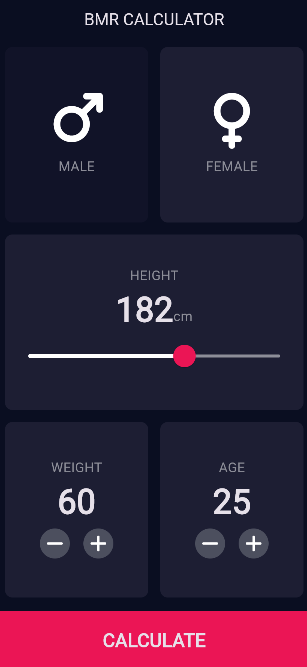
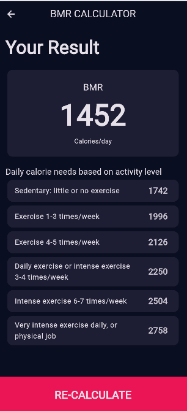

# Kalkulator BMR (Basal Metabolic Rate)

Aplikasi Flutter untuk menghitung **BMR** (Basal Metabolic Rate) dan kebutuhan kalori harian. Aplikasi ini dikembangkan dari kalkulator BMI (Body Mass Index) dengan mengacu pada [calculator.net/bmr-calculator](https://www.calculator.net/bmr-calculator.html).

## Anggota Kelompok

| No | Nama | NIM |
|----|------|-----|
| 1  | Khoirul Lathifah Oktaviani | K3524027 |
| 2  | Anisa Ramadhani | K3524045 |
| 3  | Natasya Luthfia Ramadhani | K3524063 |

## Deskripsi

**BMR** adalah jumlah kalori minimum yang dibutuhkan tubuh untuk menjalankan fungsi dasar (bernapas, sirkulasi darah, menjaga suhu tubuh) saat istirahat total. Dari nilai BMR, kebutuhan kalori harian dihitung dengan mengalikannya dengan faktor tingkat aktivitas.

Pada tugas ini, kalkulator BMI diubah menjadi kalkulator BMR. Struktur aplikasi (halaman input, halaman hasil, dan komponen UI) tetap dipertahankan, sedangkan logika perhitungannya diganti dari rumus BMI menjadi rumus BMR.

### Fitur

- Pilih jenis kelamin (Male / Female) dengan mengetuk kartu
- Atur tinggi badan dengan slider (120 - 220 cm)
- Atur berat badan dengan tombol **+** dan **-**
- Atur umur dengan tombol **+** dan **-** (batas 15 - 80 tahun)
- Menghitung BMR dengan rumus **Mifflin-St Jeor**
- Menampilkan kebutuhan kalori harian untuk 6 tingkat aktivitas
- Tombol **RE-CALCULATE** untuk kembali ke halaman input

### Rumus

| Perhitungan | Persamaan |
|-------------|-----------|
| BMR pria | `10 x W + 6,25 x H - 5 x A + 5` |
| BMR wanita | `10 x W + 6,25 x H - 5 x A - 161` |
| Kebutuhan kalori harian | `BMR x faktor aktivitas` |

Keterangan: **W** = berat badan (kg), **H** = tinggi badan (cm), **A** = umur (tahun).

### Faktor Aktivitas

| Tingkat Aktivitas | Faktor |
|-------------------|--------|
| Sedentary: little or no exercise | 1,2 |
| Exercise 1-3 times/week | 1,375 |
| Exercise 4-5 times/week | 1,465 |
| Daily exercise or intense exercise 3-4 times/week | 1,55 |
| Intense exercise 6-7 times/week | 1,725 |
| Very intense exercise daily, or physical job | 1,9 |

### Contoh Perhitungan

Wanita, umur 25 tahun, tinggi 182 cm, berat 60 kg:

```
BMR = 10 x 60 + 6,25 x 182 - 5 x 25 - 161 = 1.452 kalori/hari
```

| Tingkat Aktivitas | Kalori/hari |
|-------------------|-------------|
| Sedentary | 1.742 |
| Exercise 1-3 times/week | 1.996 |
| Exercise 4-5 times/week | 2.126 |
| Daily exercise / intense 3-4 times/week | 2.250 |
| Intense exercise 6-7 times/week | 2.504 |
| Very intense exercise daily | 2.758 |

## Alur Program

1. `main.dart` menjalankan aplikasi dan membuka `InputPage` sebagai halaman awal.
2. Pengguna mengisi jenis kelamin, tinggi, berat, dan umur di `InputPage`. Setiap perubahan memanggil `setState()` sehingga tampilan ikut diperbarui.
3. Saat tombol **CALCULATE** ditekan, dibuat objek `Calculator` dari data input, lalu aplikasi berpindah ke `ResultPage`.
4. `ResultPage` memanggil `calculateBMR()` dan `dailyCalories()` pada objek `Calculator`, lalu menampilkan BMR beserta tabel kebutuhan kalori harian.
5. Tombol **RE-CALCULATE** menutup `ResultPage` dan kembali ke `InputPage`.

## Screenshot

| Halaman Input | Halaman Hasil |
|---------------|---------------|
|  |  |

## Struktur Kode

| File | Isi |
|------|-----|
| `lib/main.dart` | Titik masuk aplikasi dan tema gelap |
| `lib/constants.dart` | Warna, gaya teks, dan enum `Gender` |
| `lib/calculator.dart` | Logika perhitungan BMR dan kebutuhan kalori harian |
| `lib/pages/input_page.dart` | Halaman input data pengguna |
| `lib/pages/result_page.dart` | Halaman hasil perhitungan |
| `lib/components/custom_card.dart` | Kartu yang dapat diketuk |
| `lib/components/icon_card.dart` | Isi kartu pilihan jenis kelamin |
| `lib/components/round_icon_button.dart` | Tombol bulat **+** dan **-** |
| `lib/components/bottom_button.dart` | Tombol besar di bagian bawah layar |

## Cara Menjalankan

Pastikan [Flutter SDK](https://docs.flutter.dev/get-started/install) sudah terpasang.

```bash
git clone <link-repository>
cd tugas-bmr-calculator
flutter pub get
flutter run
```

## Teknologi

- Flutter (Dart)
- [font_awesome_flutter](https://pub.dev/packages/font_awesome_flutter) untuk ikon

## Referensi

- [BMR Calculator - calculator.net](https://www.calculator.net/bmr-calculator.html)
